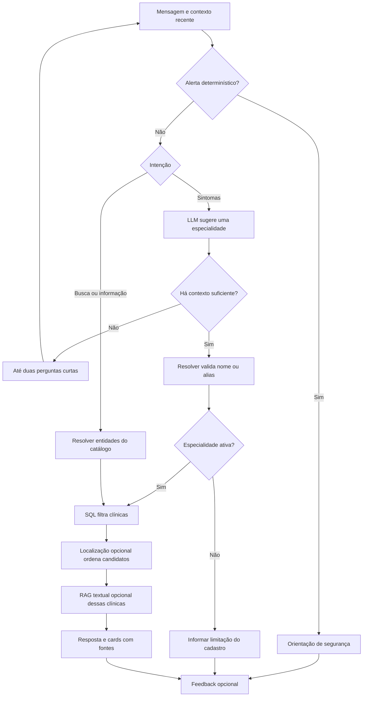

# MedFinder

Aplicação web de navegação de cuidados em React, TypeScript e Node.js. A IA sugere uma especialidade para avaliação; o backend valida o nome e busca clínicas com filtros exatos. Não realiza diagnóstico, prescrição ou agendamento.

**Versão 2.3.1:** relatos detalhados dispensam o questionário obrigatório. A idade da pessoa com o sintoma é considerada quando pode mudar o atendimento, e a orientação inclui uma descrição breve. Medicina de Família e Comunidade saiu das opções ativas. A resposta continua com zero ou uma especialidade canônica, consultas diretas ao catálogo e continuidade da conversa. São 36 unidades reais com coordenadas verificadas, localização opcional e feedback. O RAG complementa os resultados com textos de clínicas: **não decide a especialidade**.

A versão 2.3.1 integra os commits `c15dc8d` e `9682928` da equipe: fontes maiores, interface simplificada e plugins React/Tailwind na configuração dos testes, preservando os ajustes recentes do chat. [Detalhes da integração e atualização](docs/INTEGRACAO-EQUIPE.md).

## Rodar localmente no Windows, sem API paga

Na pasta que contém `package.json`, com Node.js >=22.16 e Ollama instalado:

```powershell
npm.cmd ci
ollama pull qwen3:4b-instruct-2507-q4_K_M
ollama pull bge-m3
npm.cmd run setup:ollama
npm.cmd run dev
```

Abra **http://localhost:5173**. `setup:ollama` cria o `.env` quando necessário, aplica migrações, importa o catálogo e verifica a geração. `bge-m3` é usado somente na indexação/recuperação textual opcional; a indicação de especialidade não depende dele. Não há chave ou cobrança por mensagem com modelos locais. Memória, disco, energia e desempenho dependem do seu computador. [Passo a passo Ollama](docs/OLLAMA.md).

Para quem já está usando a versão anterior: pare o servidor, faça backup de `.data` e preserve seu `.env`; atualize o código e execute:

```powershell
npm.cmd ci
npm.cmd run db:migrate
npm.cmd run setup:ollama
npm.cmd run dev
```

Não apague `.data` para atualizar. As migrações 1–9 permanecem intactas. A migração 9 mantém Medicina de Família e Comunidade desativada; a 10 habilita Pediatria sem sobrescrever uma configuração administrativa existente. `setup:ollama` também importa o catálogo ampliado e seus textos. Não rode API e manutenção simultaneamente no mesmo PGlite.

Em relatos como “minha filha está com coceira na pele e manchas desde ontem”, a idade é perguntada se estiver ausente. Uma resposta como “5” ou “8 meses” complementa o histórico. Idade conhecida não é perguntada novamente; uma filha adulta não é tratada automaticamente como criança. O serviço de Pediatria da Clínica Angellus foi confirmado na fonte oficial em 18/10/2026.

## Demonstração sem modelos

```powershell
npm.cmd ci
# Apenas se ainda não tiver um .env:
Copy-Item .env.example .env
npm.cmd run dev
```

O modo `demo` usa exemplos determinísticos e feature hashing para testar o fluxo; **não é IA generativa nem um motor clínico**. O startup local carrega 36 unidades reais e 36 resumos textuais. Experimente “Quais clínicas aceitam Unimed?” ou “Qual clínica de oftalmologia está mais perto?”. O botão “Usar minha localização” pede permissão somente após clique.

## Stack

| Camada         | Tecnologias e responsabilidade                                       |
| -------------- | -------------------------------------------------------------------- |
| Interface      | React 19, TypeScript, Vite, CSS/Tailwind, Lucide                     |
| API            | Node.js, Fastify, Zod, CORS restrito e rate limits                   |
| Banco          | PGlite local; PostgreSQL + pgvector em produção                      |
| IA             | Ollama local ou OpenAI opcional, JSON Schema + Zod                   |
| Especialidades | Taxonomia e aliases no banco; resolução exata normalizada            |
| Proximidade    | Geolocation API no navegador; Haversine no servidor                  |
| RAG            | Documentos de clínicas, chunks e busca híbrida restrita a candidatos |
| Avaliação      | Feedback no banco, sem conversa ou coordenadas                       |
| Qualidade      | TypeScript estrito, ESLint, Vitest e Playwright desktop/mobile       |

## Fluxo



A resposta apresenta **zero ou uma especialidade**, sempre validada no banco. “Oculista”, “oftalmo” e “oftalmologista” resolvem para **Oftalmologia**; nomes desconhecidos do modelo não são exibidos, inclusive no texto livre. Não há especialidades alternativas nem substituição para preencher resultados.

O chat distingue `care_navigation`, `clinic_search` e `clinic_information`. Consultas como “Onde fica a Clínica CTI?” usam dados estruturados, sem inferência médica. “E que aceite Unimed?” e “Qual dessas fica mais perto?” refinam o contexto recente em memória. Convênio e cidade não são relaxados. Proximidade não representa qualidade médica: a distância é aproximada em linha reta, não trajeto nem tempo de viagem.

## Esclarecimentos antes da recomendação

“Estou com dor de cabeça” ou “estou sentindo muita dor no pescoço” não geram uma indicação imediata. O assistente pergunta, por exemplo, quando começou e como é o desconforto. Usa as respostas seguintes e não repete tópicos já respondidos. Com descrição suficiente, pode recomendar diretamente uma especialidade; consultas de catálogo continuam dispensando entrevista.

O modelo seleciona tópicos de esclarecimento permitidos. O backend distingue relatos genéricos e idade necessária, publicando perguntas próprias, sem exigir um formulário completo nem exibir texto livre da IA. São até duas perguntas por resposta e três rodadas; se continuar faltando contexto, não força recomendação e orienta avaliação presencial. Alertas de urgência têm prioridade. A suficiência descritiva é um controle de software, não validação clínica.

## Dados e manutenção

O catálogo distribuído contém **36 unidades em Fortaleza, Eusébio, Maracanaú e Caucaia**, com fontes e datas próprias, cobrindo as 16 áreas ativas da taxonomia atual. Cadastrar uma especialidade não afirma que uma clínica a oferece. Psicologia é uma área de cuidado mantida do projeto, não uma especialidade médica do CFM.

**36 de 36 unidades têm coordenadas verificadas.** O problema anterior era a ausência desses dados nas 20 unidades do snapshot. A preparação do catálogo conferiu o ponto da unidade ou do edifício oficialmente indicado, sem usar centros de cidade. A consulta apenas lê os pares, calcula Haversine e ordena antes de paginar. Cidade vazia permite municípios vizinhos; cidade selecionada restringe a busca. [Fontes, auditoria e limites](docs/CATALOGO.md).

Comandos administrativos, sem servidor PGlite aberto:

```powershell
npm.cmd run data:import -- specialties caminho/especialidades.json
npm.cmd run data:import -- clinics caminho/clinicas.json
npm.cmd run data:import -- clinic-documents caminho/textos.json
npm.cmd run rag:reindex
npm.cmd run feedback:prune
```

Novas especialidades são cadastradas por JSON, sem recompilar. O importador de clínicas rejeita IDs não cadastrados/ativos. Veja exemplos e regras em [OPERACAO.md](docs/OPERACAO.md) e [RAG.md](docs/RAG.md).

## OpenAI opcional

O uso local com Ollama não precisa da OpenAI. Para optar pela API externa, configure `AI_PROVIDER=openai`, `OPENAI_API_KEY` no servidor, `OPENAI_MODEL` e `EMBEDDING_MODEL` no `.env`, depois execute `npm run setup:connected` e `npm run integrations:check`. A interface pede consentimento antes de enviar relatos ao provedor. Esse modo depende de acesso e cobrança da API; não publique a chave em `VITE_*`, no Git ou no navegador. [Ativação](docs/ATIVACAO.md).

## APIs e organização

`GET /api/catalog` entrega especialidades `{id,name}` do banco. `POST /api/chat` recebe mensagem, filtros e contexto opcional; `POST /api/clinics/search` recebe também localização opcional no corpo. `GET /api/clinics` não aceita posição do usuário. `POST /api/feedback` registra uma avaliação por resposta, com possibilidade de alteração. [Contratos completos](docs/API.md).

- `shared/contracts.ts`: contratos Zod, sem enum fechado de especialidades.
- `server/services/chat.ts`, `chat-intent.ts` e `specialty-resolver.ts`: navegação, roteamento e resolução.
- `server/db/`: migrations incrementais e repositories de catálogo, taxonomia e feedback.
- `server/rag/`: indexação e recuperação de documentos das clínicas selecionadas.
- `src/hooks/useGeolocation.ts`: localização explícita, compartilhada e em memória.
- `src/features/chat/ResponseFeedback.tsx`: avaliação acessível e isolada do chat.

## Privacidade

Conversas e localização ficam apenas na memória da aba e da requisição. Não usamos localStorage, sessionStorage, IndexedDB ou cookies para esses dados. Coordenadas não vão para URLs, logs, LLM ou RAG. Mensagens recebem redução de identificadores comuns antes do processamento; isso não garante anonimização.

Feedback salva voto, motivo, comentário opcional redigido e identificadores técnicos. Um comprovante de resposta guarda apenas metadados e hash de um token para autorizar o voto. Não salva relato, histórico, resposta completa ou localização. Evite incluir dados pessoais ou sintomas no comentário. O feedback mede utilidade percebida, não acurácia médica, e não treina o modelo automaticamente.

No modo Ollama, o adaptador aceita apenas loopback e modelos locais GGUF. No modo OpenAI, o relato e histórico recente são enviados após autorização; `store:false` não equivale a retenção zero de todos os sistemas do provedor. As regras determinísticas e de saída reduzem riscos, mas não substituem avaliação clínica independente.

## Verificação e operação

```bash
npm run check
npx playwright install chromium
npm run test:e2e
```

Os testes usam PGlite/pgvector reais, provedores simulados no transporte HTTP e geolocalização mockada. Eles verificam implementação e contratos, sem demonstrar eficácia clínica. [Validação](docs/VALIDACAO.md).

Produção exige PostgreSQL externo, provedor generativo, `ALLOW_DEMO_DATA=false`, `AUTO_SEED=false` e `WEB_ORIGIN` HTTPS. Aplique migrações antes de iniciar; `/api/ready` verifica banco, especialidades e catálogo. RAG é opcional e não bloqueia prontidão. Limites de uso são por processo; use gateway compartilhado para múltiplas réplicas. [Arquitetura](docs/ARQUITETURA.md) · [Operação](docs/OPERACAO.md).
