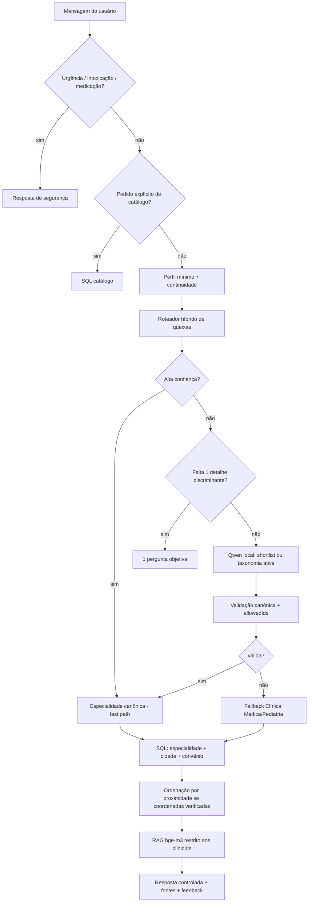

# Arquitetura MedFinder 3.0

## Objetivo

Transformar texto livre em uma **rota de atendimento**, não em diagnóstico. A saída clínica principal é uma especialidade canônica; a saída operacional é um conjunto de clínicas compatíveis com os filtros selecionados.

## Pipeline

## 1. Segurança determinística

`server/domain/safety.ts` e `server/domain/guardrails.ts` são executados antes do modelo. Sinais de emergência, possível intoxicação e pedidos de automedicação não esperam Qwen, embedding, localização ou catálogo eletivo.

Isso reduz latência e evita que um modelo pequeno precise decidir sozinho questões críticas.

## 2. Roteador híbrido

`server/domain/specialty-routing.ts` calcula candidatas com pesos sobre:

- sistema corporal;
- sintoma e contexto;
- condição já conhecida pelo usuário;
- faixa etária do paciente;
- sobreposição entre especialidades.

A regra é de **navegação**, não de diagnóstico.

### Fast path

Uma candidata só vira rota determinística quando o escore e a margem sobre alternativas são altos. Exemplos: queixa ocular → Oftalmologia; tireoide → Endocrinologia; varizes → Cirurgia Vascular/Angiologia; próstata → Urologia.

### Ambiguidade

Exemplos como rinite, tontura ou coceira em uma região musculoesquelética geram shortlist. O Qwen recebe somente candidatas autorizadas. O backend rejeita qualquer especialidade que não esteja em `allowedIds`.

### Fallback universal de navegação

Se a queixa é médica mas não permite uma especialidade específica, o sistema conserva um caminho:

- paciente adulto/idade desconhecida → Clínica Médica;
- criança/adolescente conhecido → Pediatria.

Esse fallback evita o antigo dead-end “não consegui validar” sem fingir precisão inexistente.

## 3. Qwen como árbitro semântico, não como sistema inteiro

Modelo recomendado: `qwen3:1.7b` local via Ollama.

O modelo recebe:

- mensagem atual redigida;
- histórico recente redigido;
- perfil mínimo de paciente;
- especialidades candidatas autorizadas;
- perguntas anteriores.

Retorna JSON mínimo: urgência, especialidade ou `null`, e no máximo poucos tópicos estruturados. O texto exibido ao usuário é controlado pelo backend.

Configuração: `think:false`, temperatura baixa, contexto 4096, `num_predict` curto, `keep_alive` e cache temporário da validação do modelo.

## 4. Continuidade da conversa

`careConversation()` impede que respostas como “começou ontem” sejam interpretadas isoladamente. Troca explícita de pessoa/queixa invalida a herança clínica. Confirmações curtas (“tem certeza?”) reaproveitam a especialidade já validada sem nova inferência ou RAG.

## 5. Catálogo e filtros

`CatalogRepository.search()` aplica no SQL:

- cidade exata quando selecionada;
- convênio exato/canônico;
- especialidade ativa;
- nome/bairro/endereço;
- IDs de clínicas quando a conversa referencia unidades anteriores.

O sistema **não relaxa automaticamente filtros** para “achar alguma coisa”. Zero resultados é um resultado válido e transparente.

## 6. Localização

A posição do usuário só é solicitada após clique e não é persistida. Haversine é calculado apenas quando a clínica possui latitude/longitude e procedência de verificação. Clínicas sem ponto auditado continuam disponíveis, com `distanceKm=null`.

## 7. RAG

O RAG não decide especialidade. Depois do SQL, `Retriever.search()` recebe somente os IDs das clínicas candidatas. `bge-m3` recupera texto cadastral para enriquecer a resposta e mostrar fontes sem expandir o universo de clínicas.

Esse desenho evita o erro “RAG escolheu uma clínica de outra especialidade”.

## 8. Privacidade

- localização do usuário não é persistida;
- identificadores comuns são redigidos antes do provedor;
- Ollama é validado como modelo local GGUF;
- respostas/feedback usam tokens separados;
- o navegador não armazena a conversa; apenas o mecanismo específico de follow-up pode usar a chave prevista pelo projeto.

## 9. Complexidade técnica demonstrável

O projeto combina React/TypeScript, Fastify, PGlite/PostgreSQL, pgvector, RAG, embeddings, LLM local, roteamento determinístico, validação Zod, geolocalização, Haversine, migrações, rate limiting, feedback, testes unitários/integrados/E2E e governança de dados.
